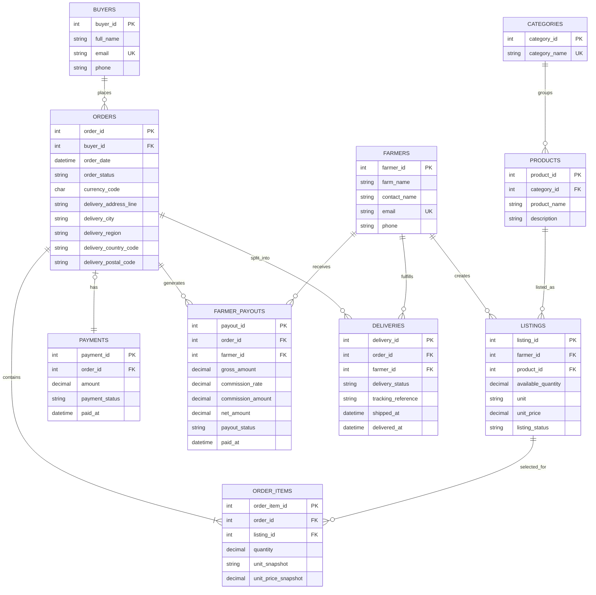

# Portfolio 1: Database Design and Modelling

## Case study: Farm Commerce City (Farmccity)

Farm Commerce City, known as Farmccity, is a fictional online marketplace that connects farmers who sell fresh produce with buyers who place orders. Farmers create listings for available produce, including the product, quantity, unit of measure, and price. Buyers can combine items from several farmers in one order.

The database supports buyer and farmer records, produce listings, orders, payments, farmer payouts, and delivery tracking. A buyer makes one payment for an order. Each farmer fulfills their own items and has a separate delivery record for that order.

## Business rules

1. A buyer may place multiple orders.
2. One order may contain items supplied by multiple farmers.
3. Each order item refers to one farmer's produce listing.
4. Checkout creates one simulated payment record for an order. The database allows at most one payment record per order.
5. After a successful payment is recorded, each farmer with items in the order receives a separate simulated payout marked as paid.
6. The marketplace commission is 1% of each farmer's produce subtotal for the order. The payout amount is the farmer's subtotal less that commission.
7. The first version records payment and payout status for coursework. It does not connect to a real payment provider or move money.
8. The marketplace uses NGN for its monetary values.
9. Each buyer order has one delivery destination shared by the farmers fulfilling that order. The destination is saved on the order so that later address changes do not alter its delivery history.

## Intended database users

- Buyers who browse produce and place orders
- Farmers who manage produce listings and fulfill orders
- Marketplace administrators who manage the service and review transactions

## Portfolio 1 scope

This portfolio will document the case study, design an entity relationship diagram, map it to a relational schema, identify keys and constraints, and explain normalization. PostgreSQL will be used to implement and test the design.

## Entity relationship diagram



### Diagram notes

- Each order item stores the unit and price at checkout so later listing changes do not alter the order history.
- Checkout creates a simulated payment record for an order. The unique constraint on `PAYMENTS.order_id` allows at most one payment per order.
- Each farmer can have at most one payout and one delivery for an order. The corresponding tables use unique constraints on `(order_id, farmer_id)`.
- A farmer payout is calculated from that farmer's order item subtotal. The commission rate is recorded as `0.01`, and the net payout is the subtotal less the 1% commission.
- Order prices, payments, and payouts use NGN. The address stored on an order is the delivery destination for each farmer's delivery in that order.
- Payment and payout records are examples for the coursework database. They do not transfer real money.
- The table constraints check payout arithmetic, but they do not prove that the farmer has items in that order or that the payment matches the order total. Those cross-table rules will be checked in a transaction exercise in Portfolio 3.

## Relational schema and normalization

The PostgreSQL table definitions are in [`schema.sql`](./schema.sql), and the example records are in [`sample_data.sql`](./sample_data.sql). The main keys and relationships are:

| Table | Primary key | Foreign keys and additional constraints |
|---|---|---|
| `buyers` | `buyer_id` | `email` is unique |
| `farmers` | `farmer_id` | `email` is unique |
| `categories` | `category_id` | `category_name` is unique |
| `products` | `product_id` | `category_id` references `categories`; category and product name are unique together |
| `listings` | `listing_id` | `farmer_id` references `farmers`; `product_id` references `products` |
| `orders` | `order_id` | `buyer_id` references `buyers` |
| `order_items` | `order_item_id` | `order_id` references `orders`; `listing_id` references `listings`; each listing appears at most once in an order |
| `payments` | `payment_id` | `order_id` references `orders` and is unique |
| `farmer_payouts` | `payout_id` | `order_id` and `farmer_id` reference their parent tables; the pair is unique |
| `deliveries` | `delivery_id` | `order_id` and `farmer_id` reference their parent tables; the pair is unique |

The design follows the first three normal forms. Each field stores a single value, and each order item is a separate row. Buyer and farmer details are kept in their own tables rather than repeated in orders. Products and categories are separate, so a category name is stored once. Listing prices belong to farmer listings, while the order item keeps the price and unit from checkout as a historical snapshot. Order totals can be calculated from the order items. Payment and payout amounts are stored as transaction records so the simulated financial activity can be checked later.

## Practical implementation and checks

The database was created as `farmccity_db`. The schema and sample records were loaded with PostgreSQL 18 using `psql`. The sample order contains two farmers' produce, one buyer payment of NGN 14,000, and two farmer payouts.

To load the scripts into a new, empty database, run these commands from this folder:

Run the first command once. If `farmccity_db` already exists, skip it.

```powershell
& "C:\Program Files\PostgreSQL\18\bin\psql.exe" -h localhost -U postgres -d postgres -W -c "CREATE DATABASE farmccity_db;"
& "C:\Program Files\PostgreSQL\18\bin\psql.exe" -h localhost -U postgres -d farmccity_db -W -v ON_ERROR_STOP=1 -f "schema.sql"
& "C:\Program Files\PostgreSQL\18\bin\psql.exe" -h localhost -U postgres -d farmccity_db -W -v ON_ERROR_STOP=1 -f "sample_data.sql"
```

In `psql`, `\dt` lists the tables. The command `\d farmer_payouts` shows the payout keys and checks. The sample data query displays the buyer payment and each farmer's gross amount, commission, and net payout.

To verify that the constraints reject invalid changes, connect to `farmccity_db` and try these statements one at a time:

```sql
UPDATE listings SET available_quantity = -1 WHERE listing_id = 1;

INSERT INTO payments (order_id, amount, payment_status, paid_at)
VALUES (1, 14000.00, 'paid', CURRENT_TIMESTAMP);

INSERT INTO farmer_payouts (
    order_id, farmer_id, gross_amount, commission_rate,
    commission_amount, net_amount, payout_status, paid_at
)
VALUES (1, 999, 100.00, 0.0100, 1.00, 99.00, 'paid', CURRENT_TIMESTAMP);
```

Each statement should be rejected. The first violates the nonnegative listing quantity check, the second duplicates the payment for order 1, and the third references a farmer that does not exist. Since each statement fails, it should not change the sample records.

The row counts after the failed statements should remain at two listings, two order items, one payment, and two farmer payouts. Screenshots of the schema, sample query, and constraint checks are stored in `Evidence/`.

## AI use declaration

Copilot assistance in VS Code was used to help discuss the case study and draft the ER diagram, PostgreSQL schema, sample records, and README. The SQL was run in PostgreSQL 18, and the sample payouts and database constraints were checked. The design choices and practical results should be explained in the student's own words in the final submission.

## Design deliverables

- [x] Entity relationship diagram
- [x] Relational schema with keys and constraints
- [x] PostgreSQL schema and sample data
- [x] Normalization explanation
- [x] Implementation and test evidence

## Practical work log

Record the PostgreSQL commands you run, the results you observe, and any design changes you make. Add your own screenshots or other evidence before submitting this portfolio.
